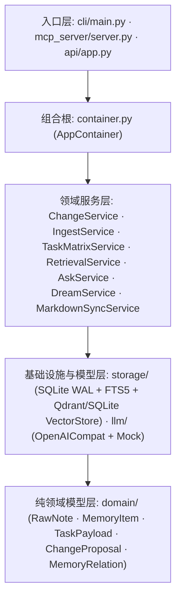

# Trace-Memory 系统架构设计详解

本文档面向开发者与技术面试复盘，详细说明 `trace-memory` 如何将 **随心记 (`suixinji`)**、**`basic-memory`** 与 **`ReMe`** 的核心设计融合进一套干净、无历史包袱的单体/可扩展架构中。

---

## 1. 核心架构分层与依赖方向

系统严格遵循 **单向依赖与显式组合根（Composition Root）注入原则**（仅 [`config.py`](../src/trace_memory/config.py) 与 [`container.py`](../src/trace_memory/container.py) 读取环境变量，下层全部通过显式构造参数接收依赖）：

---

## 2. 五大关键子系统设计机制

### 2.1 统一变更提案契约（`ChangeService` + CAS 乐观锁）
- **设计位置**：[`domain/proposals.py`](../src/trace_memory/domain/proposals.py)、[`services/change_service.py`](../src/trace_memory/services/change_service.py)
- **解决的问题**：多入口（抽取器、Web 页面手改、MCP 外部 Agent、Markdown 编辑回流、Dream 后台归纳）同时修改同一条记忆时容易出现并发覆盖、越权或 AI 改坏人工排期。
- **核心机制**：
  1. **数据库级原子 CAS**：`UPDATE memories SET ..., version = expected + 1 WHERE memory_id = ? AND version = ?`，影响行数为 0 立即抛出 `VersionConflictError`。
  2. **时间因果顺序栅栏（C01）**：针对语义事实（如居住地），比较 `event_time`；晚录入的旧历史自动沉淀进 `previous_values` 和版本链，绝不覆盖当前最新状态。
  3. **用户锁定保护（C06）**：人工在 Web 或 Markdown 调整过的卡片自动标记 `user_locked=True`，后续自动抽取和 Dream 归纳遇到该标记自动跳过覆盖。

### 2.2 记忆驱动的待办四象限引擎（`TaskMatrixService`）
- **设计位置**：[`domain/memories.py`](../src/trace_memory/domain/memories.py)、[`services/task_matrix_service.py`](../src/trace_memory/services/task_matrix_service.py)
- **评分与四象限映射公式**：
  - 抽取时评估基础重要度 $I \in [1, 5]$ 与基础紧急度 $U_0 \in [1, 5]$，并结合当前空间的 `preference`（正向偏好记忆）自动校准提升匹配主题任务的 $I$。
  - 读取时结合当前时间 $t_{\text{now}}$ 与 `due_at` 动态计算实时紧急度 $U_{\text{eff}}$（逾期或剩余 $\le 24\text{h}$ 升至 5 分，$\le 48\text{h}$ 至少升至 4 分）。
  - $I \ge 4 \land U_{\text{eff}} \ge 4 \Rightarrow \text{Q1}$；$I \ge 4 \land U_{\text{eff}} < 4 \Rightarrow \text{Q2}$；$I < 4 \land U_{\text{eff}} \ge 4 \Rightarrow \text{Q3}$；其余为 $\text{Q4}$。
  - 综合优先级分：$\text{Score} = \text{Base}(Q) + 5I + 4U_{\text{eff}} + \text{DeadlineBonus} - \text{BlockerPenalty}$。

### 2.3 可插拔向量数据库、RRF 混合检索与向量生命周期
- **设计位置**：[`storage/vector_store.py`](../src/trace_memory/storage/vector_store.py)、[`storage/hybrid_search.py`](../src/trace_memory/storage/hybrid_search.py)
- **双路召回融合**：
  - **稀疏路（BM25）**：通过 CJK 二元分词 + 英文词元构建 SQLite FTS5 索引，精准命中专有名词与错误码。
  - **稠密路（Dense Vector）**：通过 `VectorStore`（支持 `QdrantVectorStore` 本地 HNSW / 远程服务及 `SQLiteVectorStore` 余弦检索）捕捉跨字面同义概念（如*“线上结算隐患”*召回*“微信支付回调超时 bug”*）。
  - **RRF 融合**：$\text{Score}_{\text{RRF}}(d) = \frac{1.15}{k + r_{\text{bm25}}(d)} + \frac{1.0}{k + r_{\text{vec}}(d)} + 0.02 \cdot \cos(q, d)$。
- **向量生命周期闭环（`VectorLifecycleService`）**：当记忆状态变为 `superseded` 或 `forgotten`（含 `RawNote` 局部跨度脱敏 C07）时，同步从向量集合中物理删除或重算脱敏向量，并在检索时执行 Metadata 前置过滤（`space_id` + `status == 'active'`）。

### 2.4 受控双链图谱与前向悬空引用解析
- **设计位置**：[`storage/repositories.py`](../src/trace_memory/storage/repositories.py) (`RelationRepository`)、[`services/retrieval_service.py`](../src/trace_memory/services/retrieval_service.py)
- 支持 `[[目标固定链接或标题]]` 建立有向关系边：目标尚不存在时保留 `to_target_text`（`to_memory_id=""`），目标创建时通过 `resolve_pending_inbound` 自动连线；目标遗忘时回退为未解析状态并在多跳展开（`build_graph_context`）中严格拦截。

### 2.5 Markdown 派生视图与 `.manifest.json` 冲突保护回流
- **设计位置**：[`services/markdown_sync.py`](../src/trace_memory/services/markdown_sync.py)
- 导出目录 `knowledge/<space_id>/` 是纯派生视图，随时可删目录重建；`.manifest.json` 记录导出时的 `(memory_id, version, sha256)`，避免重扫死循环，并在并发冲突时将用户旧版修改另存为 `*.conflict-vN.md` 草稿。
